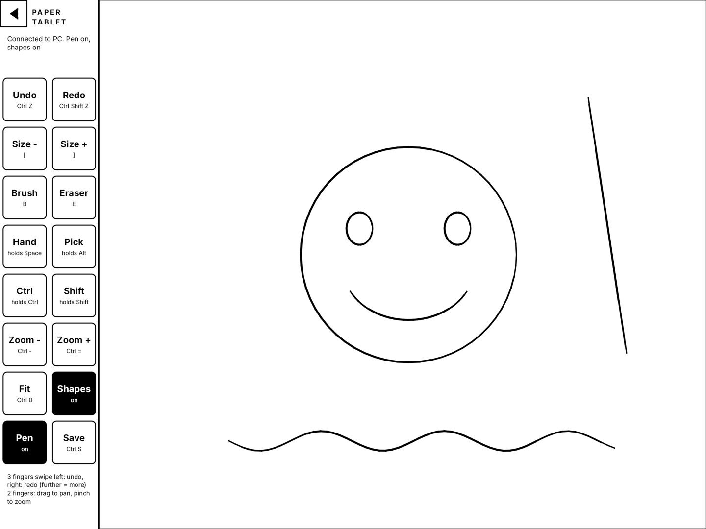
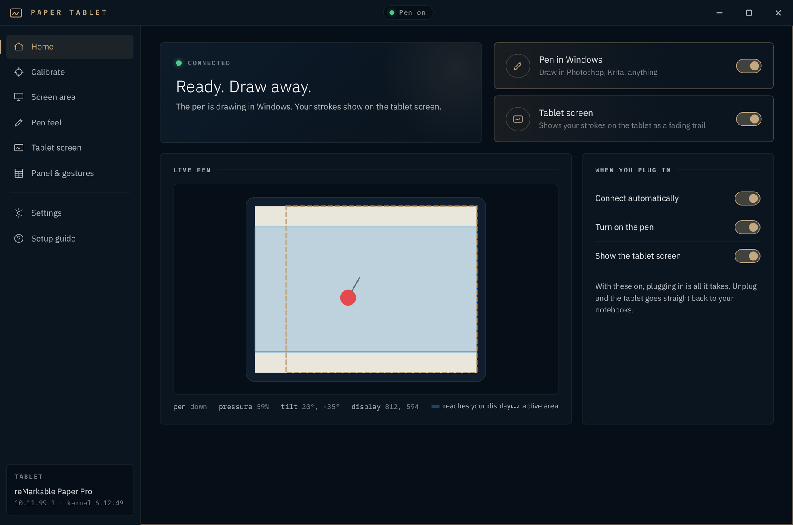
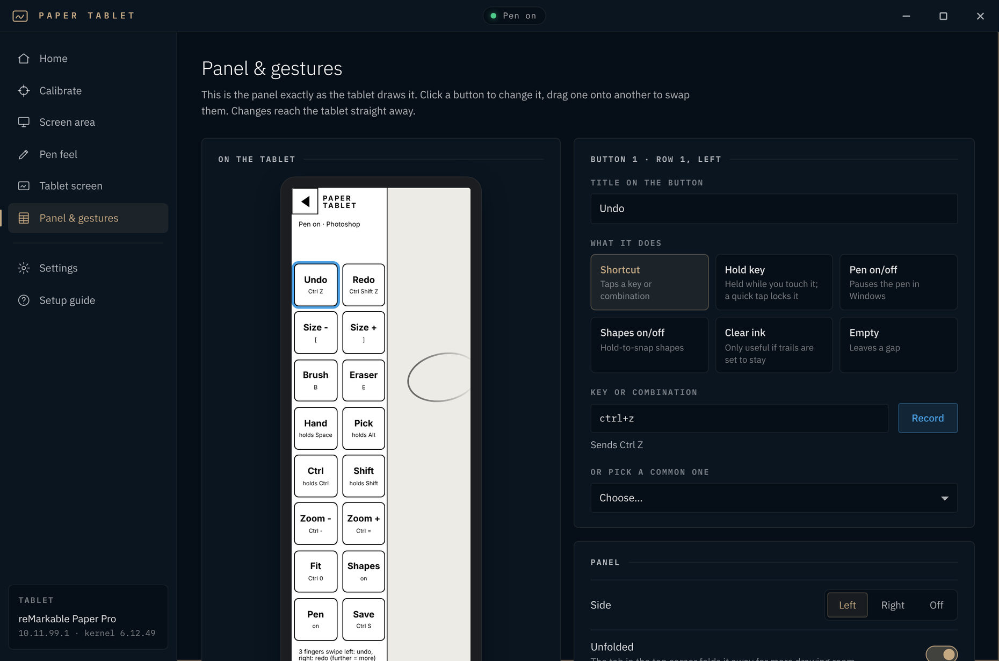
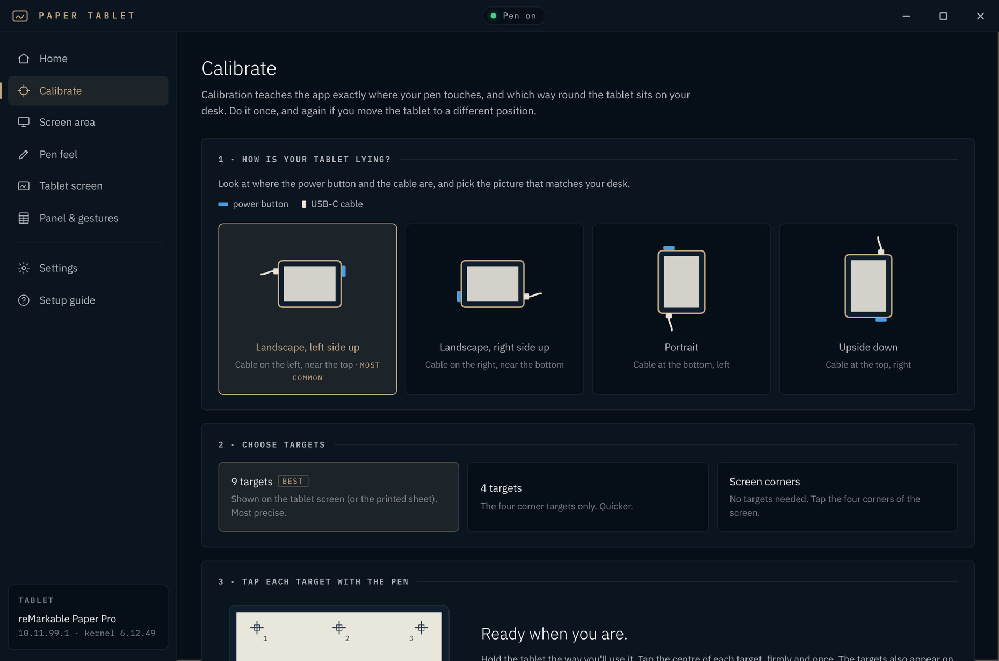
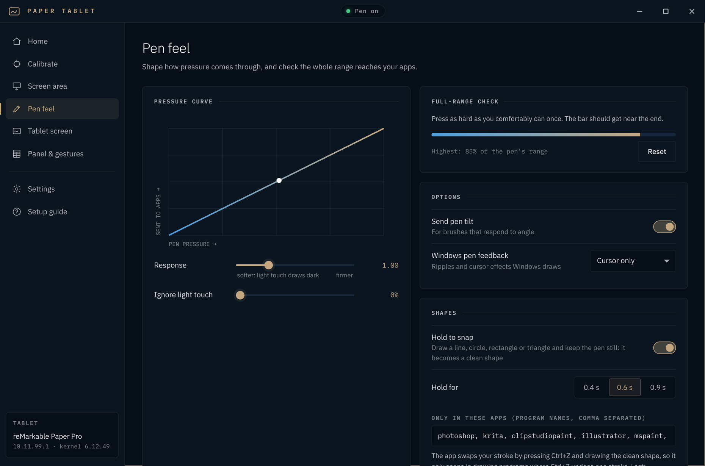
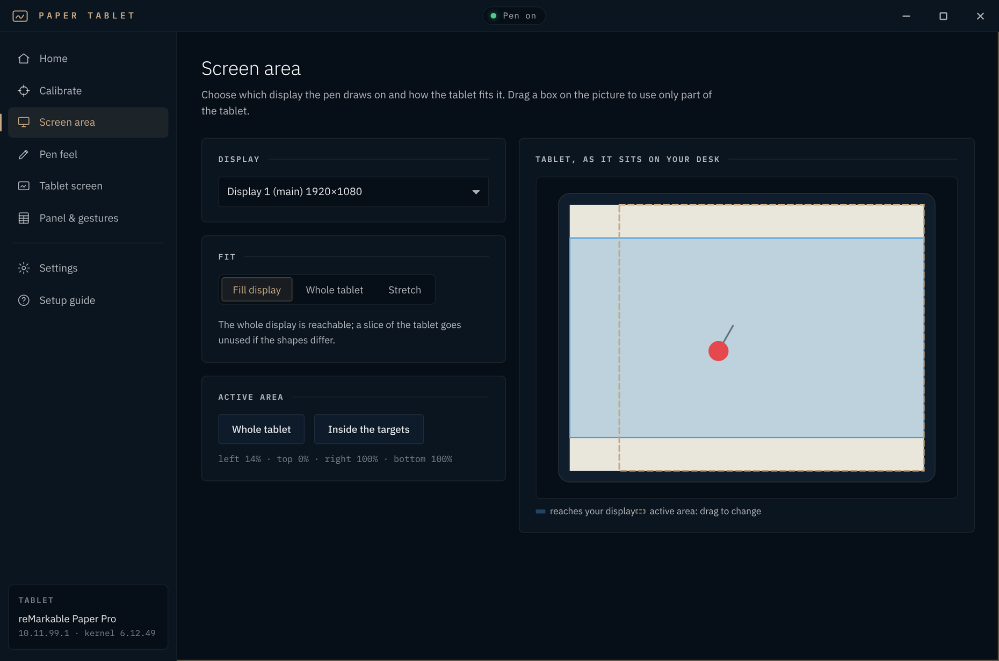

# Paper Tablet

**Use a reMarkable Paper Pro as a pressure-sensitive pen tablet for Windows.**

Plug the tablet into your PC with its USB cable and draw in Photoshop, Krita, Clip Studio, Illustrator or any
Windows Ink app. You get pressure, tilt, hover and the eraser end. The tablet's own screen shows your
strokes as a fading trail. A side panel puts your shortcuts under your other hand, and finger gestures
handle undo, redo, pan and zoom.

> Paper Tablet is an independent project. It is not made, endorsed or supported by reMarkable AS.
> It needs **developer mode** on the tablet, which is your own decision; read the safety notes below.

## Features

- **A real Windows pen.** It uses Windows' own pen input (Windows Ink), so apps see a pen, not a mouse,
  and no driver is needed. You get 4096 pressure levels, tilt, hover and the eraser end.
- **Plug and play.** Plug in and the pen and the tablet screen start. Unplug and the tablet goes back to your
  notebooks within seconds. Nothing is installed permanently on the tablet.
- **Calibration** with 9, 4 or 0 targets. It learns exactly where the pen lands and which way round the
  tablet sits on your desk.
- **Screen area.** Pick a display, choose fill / whole tablet / stretch, and drag out the part of the tablet
  you want to use. A stroke that runs off that part lifts, instead of drawing along the screen edge.
- **Pen feel.** A pressure curve, a light-touch threshold, a full-range check, and tilt on or off.
- **Hold to snap.** Draw a line, circle, ellipse, triangle, rectangle or polygon, then hold the pen still and
  it becomes a clean shape, as in the tablet's own notebooks.
- **Shortcut panel on the tablet.** 16 buttons you design yourself in the desktop app: any title and any key
  combination. A button can tap its keys or hold them (for Space-to-pan, Alt-to-pick and the like).
  The panel folds away from its corner tab when you want the whole surface. Keep as many named button sets
  (profiles) as you like, for example one per app, and switch with the arrows at the top of the panel.
- **Paper and tracing on the tablet screen.** Lined, squared, dot, cross, blueprint or isometric paper under
  your strokes, and a tracing image you can move and zoom with your fingers. The front light can go to full
  while you trace, and comes back to your level afterwards.
- **Pen mask (Screen area page).** Works like a stencil in shades of grey: black ignores the pen, white leaves it
  alone, and grey either fades the pressure (mid grey gives half) or needs a firmer press. Paint it on the
  tablet and drag it where you need it, or make it from any image, read in greyscale.
- **Finger gestures:**
  - Three-finger swipe for undo and redo, one step per stretch of the drag, live as you swipe.
  - Two-finger drag to pan and pinch to zoom; five-finger twist to rotate the canvas.
  - Tap gestures you can assign (one-finger triple tap = new layer by default).

  Fingers are ignored while the pen is near the screen, and palm-sized contacts are ignored always, so a
  resting hand does nothing.

| | |
|---|---|
|  |  |
|  |  |

*(The desktop screenshots show the app with sample data.)*

## Requirements

- A **reMarkable Paper Pro** with **developer mode** turned on. Tested on software 3.29.
- **Windows 10 (1809 or newer) or Windows 11**, and the USB-C cable. Linux: preview, see below.
- The installer and portable version bring everything else with them. Running from source needs Python 3.10+.

## Install

Download from [Releases](../../releases):

- **`PaperTablet-Setup-x.y.z.exe`** installs for your user account only, with no admin rights. You get a
  Start-menu entry, and an uninstaller removes it cleanly.
- **`PaperTablet-Portable-x.y.z.zip`** needs no installation. Unzip it anywhere, even onto a USB stick, and run
  *Paper Tablet*. Settings, calibration and the app's key stay in the `data` folder next to it, so nothing
  is left on the PC.

The builds aren't code-signed yet, so Windows SmartScreen may warn the first time you run them
(*More info → Run anyway*).

**Linux (preview, first build):** see [linux/README-linux.md](linux/README-linux.md). It installs with one
script and uses a virtual tablet device, so it works on Wayland (Hyprland, Sway, GNOME, KDE).

**From source:** clone this repo and double-click `Paper Tablet.bat`. It installs `paramiko` and `pywebview`
once, then starts the app.

## First run

The setup guide opens by itself and walks you through it:

1. **Back up your notebooks.** Developer mode resets the tablet.
2. **Turn on developer mode** on the tablet, then plug it into the PC.
3. **Pair.** Type the tablet's password once (it's shown on the tablet under *Settings → General → Help →
   About → Copyrights and licenses*). The app uses it once to install its own key on the tablet, and never stores it.
4. **Tell it how the tablet lies on your desk, then calibrate.**

After that, plugging in is all it takes.

## Using it

**In your drawing app.**
- Photoshop uses Windows Ink by default. Turn on *Pen Pressure* for brush size or opacity. If a
  `PSUserConfig.txt` containing `UseSystemStylus 0` exists in Photoshop's settings folder, remove it.
- Krita, Clip Studio, Illustrator and Affinity: choose their *Windows Ink* or *Windows Pointer* tablet mode.
- Apps that only speak **WinTab** see a pen without pressure.

**Shortcut panel.** It sits on the left or right edge of the tablet, about 34 mm wide, with 8 rows of 2 buttons.
- **Editing.** On the *Panel & gestures* page, click a button to set its title and what it does, and drag one
  onto another to swap them. To set keys, press *Record* and hit the keys, or type something like `ctrl+shift+s`.
- **Button types:**
  - *Shortcut* taps its keys.
  - *Hold key* holds them while your finger stays on the button. A quick tap (or the pen) locks it until you tap again.
  - *Pen on/off* and *Shapes on/off* switch those features.
  - *Clear ink* wipes the tablet's trails.
  - *Empty* leaves a gap.
- **Defaults:** Undo, Redo, brush size −/+, Brush, Eraser, Hand (hold Space), Pick (hold Alt), Ctrl, Shift,
  Zoom −/+, Fit, Shapes, Pen, Save.
- **Folding.** The triangle in the panel's top corner folds the panel away, and the drawing area grows to
  the full width.

**Gestures** (switch them off on the same page):

| Gesture | Does |
|---|---|
| 3 fingers, swipe left / right | Undo / redo. One step per ~11 mm of swipe, live, and dragging back takes steps back (Short / Medium / Long) |
| 2 fingers, drag | Pan (holds Space and drags, like the hand tool) |
| 2 fingers, pinch | Zoom in / out (Ctrl+= / Ctrl+-) |
| 5 fingers, twist | Rotate the canvas (holds R and drags round the window centre; Shift+Space for Krita / Clip Studio) |
| 1 finger, triple tap | New layer (Ctrl+Shift+Alt+N), changeable |
| 5 fingers, double tap | Reset the canvas rotation (holds R and presses Esc; Krita: `5`), changeable |
| 5 fingers, swipe down | Clear the tablet ink and cleanly refresh the whole screen (clears e-ink leftovers) |
| 1-finger double tap, 2-finger tap and double tap, 3-finger tap | Off until you assign keys |

The default shortcuts follow Photoshop. Krita and Clip Studio use most of the same keys; change any that differ.

**Hold to snap.** Draw a shape and keep the pen still for 0.6 s. The app lifts the pen, presses Ctrl+Z to
remove your stroke, and draws the clean shape with your stroke's own pressure. Because it relies on Ctrl+Z
removing exactly one stroke, it only works in the drawing programs listed on *Pen feel*.

## Safety: what it does to your tablet

- **Nothing permanent.** The pen helper and the tablet-screen app are copied to `/tmp` (cleared on every reboot)
  and run only while you use them.
- While the tablet screen is on, the notebook app is paused. It is **always restarted** when the screen is
  turned off, the cable is pulled, the PC app closes or crashes, or you press the power button. If the tablet
  ever stays blank, hold the power button to restart it.
- Your notebooks are never read or changed.
- Login uses an SSH key the app makes for itself. The tablet password is used once to install that key, and
  is never saved. The connection stays on the USB link (10.11.99.1).
- Developer mode itself is reMarkable's feature, and turning it on resets the tablet. Read reMarkable's own
  guide first.

## Building

- **Run the tests:** `cd pc && python -m unittest test_shapes test_rmtablet test_panel`.
- **The tablet programs** are built with reMarkable's official Paper Pro SDK
  (`SDK=/path/to/sdk tablet/companion/build.sh`). Prebuilt binaries are in the repo.
- **The installer and portable zip** are built with the scripts in `installer/` (embedded Python + Inno Setup).
- **Portable mode** works with any copy: put an empty file named `portable` (or `portable.txt`) next to
  `Paper Tablet.bat` or the exe, and everything is kept in `data\` beside it.

[docs/TECHNICAL.md](docs/TECHNICAL.md) covers how it works: measured hardware ranges, the tablet-screen app,
and the command-line tool.

## Licence

MIT, see [LICENSE](LICENSE). The bundled IBM Plex fonts are under the SIL Open Font License
(`pc/web/fonts/OFL-IBM-Plex.txt`). The tablet-screen app links against the Qt libraries already on the tablet.
"reMarkable" and "Paper Pro" are trademarks of reMarkable AS, used here only to say which device this works with.
